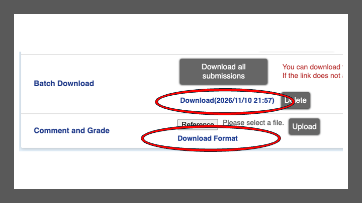

# LUNA Assignment Grader

A fast, keyboard-driven way to grade assignments downloaded from **LUNA** (Kwansei Gakuin University's LMS), including scores, feedback comments and late flags, and to send the grades back to LUNA in its own upload format.

It runs entirely in your web browser. **Nothing is uploaded or stored anywhere except your own computer**: student files are read from your folders, and your grades are saved back into those same folders.

**Open the grader:** https://brandonlkramer.github.io/LUNA-Assignment-Grader/ (or download `index.html` from this repository and double-click it in Chrome or Edge).

[日本語の説明は下にあります](#日本語の説明)

---

## Contents

1. [What you need](#what-you-need)
2. [One-time setup](#one-time-setup)
3. [Grading an assignment, step by step](#grading-an-assignment-step-by-step)
4. [Keyboard shortcuts](#keyboard-shortcuts)
5. [Settings: scores, comment banks and formatting requirements](#settings)
6. [Word files and iPhone photos](#word-files-and-iphone-photos)
7. [Where your work is saved](#where-your-work-is-saved)
8. [Troubleshooting](#troubleshooting)
9. [Privacy](#privacy)
10. [For maintainers: publishing and building](#for-maintainers)

---

## What you need

- **Google Chrome or Microsoft Edge** on a Mac or Windows computer. Safari and Firefox can't open and save to folders the way the grader needs.
- Access to your course in LUNA.

Nothing needs to be installed.

---

## One-time setup

### 1. Add your classes

1. Open the grader and click **Add classes** (or **Edit classes and settings**).
2. Click **+ Add a class**, type the class name, and repeat for each class.
3. Click **Save**.

### 2. Choose a folder for each class (once)

The first time you open a class, the grader asks where to keep that class's grading files. Choose any folder, usually the class's own folder on your computer. Chrome then asks for permission to view and save files there; click **Allow** (or **Edit files**).

The grader then **makes a folder called `LUNA Assignments` inside the folder you chose.** All of that class's LUNA downloads go there.

```
Academic Writing/                 ← the folder you chose
└── LUNA Assignments/             ← made for you by the grader
```

Folders in Box, Dropbox, OneDrive or iCloud work fine, and your saved grades then sync with them. Chrome remembers each class's folder; in later sessions you may be asked to click **Allow** once more, which is Chrome protecting your files. You can change a class's folder at any time in **Settings → Choose folder…**.

---

## Grading an assignment, step by step

### 1. Download two things from LUNA

On the assignment's page in LUNA you need two downloads, shown circled below:



1. **The students' work.** Under **Batch Download**, click **Download all submissions**. When the **Download (date and time)** link appears below it, click that link. You get a **.zip** file.
2. **Unzip it into the class's `LUNA Assignments` folder** (Mac: double-click the .zip; Windows: right-click → *Extract All*). This makes a folder named like `2026_32017003_assignment_status_Week_1_Homework_…`, containing files such as `32026337_essay.docx`; each file name starts with the student's ID. **The grader can't read the .zip itself, so this step is needed.**
3. **The grading template.** Under **Comment and Grade**, click **Download Format**. You get a file named like `2026_32017003_assignment_comment_format_250565.xlsx`: LUNA's upload template, with one row per student. The grader fills in the scores and comments.
4. **Move the grading template into the unzipped folder from step 2**, so everything for one assignment is together. Leaving it directly in `LUNA Assignments` also works.

The grader has the same instructions with this picture: click **How to download from LUNA** on its start screen.

```
LUNA Assignments/
└── 2026_32017003_assignment_status_Week_1_Homework_…/       ← unzipped Batch Download
    ├── 32026337_essay.docx                                    ← students' work
    ├── 32026355_IMG_0655.HEIC
    ├── …
    ├── assignment_comment_250565.xlsx                         ← comes with the download
    └── 2026_32017003_assignment_comment_format_250565.xlsx    ← grading template (Download Format)
```

The number at the end (here `250565`) is how the grader knows which upload file belongs to which download.

### 2. Open the class and the assignment

Open the grader, press the class's number (or click it), then press the assignment's number. Each assignment shows how many students submitted and how many you've graded.

### 3. Grade

- The **left** column lists students who submitted. **LATE** ones are marked in red, with a red banner above their work.
- The **middle** shows the student's work. If a student sent several files, switch between them with **← →**.
- The **right** side is where you give a score and a comment. Everything **saves automatically** as you type.

A typical rhythm: look at the work → press **1–9** for a quick score (or **S** to type one) → **C** to write a comment, or **Alt+1–9** to add one from your comment bank → **⌘/Ctrl+Enter** to save and move to the next student.

Use the list's drop-down to show **Ungraded**, **Flagged**, **Late** or **No submission** students. **N** jumps to the next ungraded student.

### 4. Save the upload file

When you've finished, click **Save LUNA upload file** (top right). The grader writes a new file into the assignment's download folder, named like:

> `2026_32017003_assignment_comment_format_250565_GRADED.xlsx`

It is a copy of LUNA's upload file with only the **Score** and **Feedback Comments** filled in. LUNA's original file is never changed. You can press Save again at any time; it overwrites the `_GRADED` file with your latest grades.

### 5. Upload it to LUNA

On the assignment's page in LUNA, under **Comment and Grade**, click **Reference**, choose the `_GRADED.xlsx` file, then click **Upload**. (These are the buttons next to **Download Format** in the picture above.)

---

## Keyboard shortcuts

Press **?** in the grader to see these at any time.

| Key | Action |
|---|---|
| **1–9** on the start screens | Choose a class / an assignment |
| **J** or **↓** / **K** or **↑** | Next / previous student |
| **N** | Next *ungraded* student |
| **→** / **←** | Next / previous file of the same student |
| **1–9** | Quick score |
| **S** | Type a score (then **Enter** moves to the comment) |
| **C** | Type a comment |
| **Alt+1–9** (⌥ on Mac) | Add a comment from the comment bank (works while typing) |
| **⌘/Ctrl+Enter** | Save and go to the next student (works while typing) |
| **Esc** | Leave the text box so shortcuts work again (press twice to go back to the assignment list) |
| **F** | Flag / unflag the student for later |
| **Z** | Images and Word pages: fit to window / actual size |
| **R** | Images: rotate 90° |
| **I** | Word: show / hide full formatting details |
| **W** | Word: open the student's file in Word |
| **Space** | Audio / video: play / pause |
| **O** | Open the file in a new tab |
| **D** | Download the file |
| **/** | Search students |

If you click inside a PDF, the PDF viewer takes over the keyboard. Press **Esc** or click the right-hand panel to get the shortcuts back.

---

## Settings

Click **Settings**. Under **Settings for**, choose a class to give it its own settings, or choose *Default* for the settings used by any class that has none of its own.

- **Maximum score:** shown next to the score box; you're warned if a score goes above it.
- **Quick scores:** for example `10, 9, 8, 7, 6, 5, 0`. The first nine go on keys 1–9. For a simple *none / half / full* scheme, use `0, 5, 10`.
- **Word formatting requirements (optional):** font, font size, line spacing, margins, paper size and a word range. Each Word file then shows these as green ✓ or red ✗. Leave a box empty to skip that check.
- **Comment bank:** one comment per line. The first nine can be added with Alt+1–9, and the panel's **edit** link opens this directly.
- **Classes:** rename classes, change a class's folder (**Choose folder…**; a `LUNA Assignments` folder is made inside it if there isn't one), or remove a class. Removing a class never touches its files.

---

## Word files and iPhone photos

### Word (.docx)

Word files are shown as pages, keeping the paper size, margins, fonts, sizes, spacing, indents, alignment, headers and footers, tables and page breaks.

Above each document, a **formatting summary** shows values read directly from the Word file itself:
- paper size and margins;
- main font and size, with percentages, so a stray sentence in another font shows up;
- line spacing and alignment;
- word count and page count.

Press **I** for the full breakdown, which adds paragraph spacing, first-line indent, the Japanese line grid and page numbers.

The page view is a close approximation, not Word itself:
- line and page breaks can fall slightly differently;
- a font that isn't installed on your computer is replaced, and the summary warns you when that happens;
- text boxes and drawn shapes may not appear exactly.

**The formatting summary is always exact.** To see the document exactly as Word shows it, press **W**.

**Making W open Word automatically (one-time):** the first time you press W, Chrome downloads a copy of the file. Click Chrome's download icon (top right), click **…** next to the file, and choose **Always open files of this type**. From then on, W opens the file straight in Word. These copies go to your Downloads folder; the student's original is never changed.

Older `.doc` files can't be previewed; press W or D to open them.

### iPhone photos (.HEIC)

HEIC photos are converted and shown like any other image. A large photo can take a few seconds the first time.

### Other files

PDFs, images (JPG, PNG and others), Excel files, text files, audio and video are shown directly. Anything else can be opened with **O** or downloaded with **D**.

---

## Where your work is saved

| What | Where |
|---|---|
| Your scores and comments, while you grade | `luna-grader_<number>.json` in the assignment's download folder (plus a backup copy in the browser) |
| The file you upload to LUNA | `…assignment_comment_format_<number>_GRADED.xlsx` in the same folder |
| Your classes, comment banks and settings | In the browser on this computer |

Because grades are saved in the assignment folder, you can close the browser at any time and continue later, even on another computer if the folder syncs (Box, Dropbox and so on). Your **settings** stay in the browser, so on another computer you add your classes again.

---

## Troubleshooting

| Problem | What to do |
|---|---|
| An assignment says **"grading template not downloaded yet"** | In LUNA, under **Comment and Grade**, click **Download Format**, and move the file into that assignment's folder. Your grades are safe meanwhile. |
| An assignment says **"students' files not downloaded yet"** | Under **Batch Download**, download and unzip the students' submissions into `LUNA Assignments`. |
| A **"still zipped"** or **"download in progress"** message | Wait for the download to finish, unzip it, then press **R** (Refresh). The grader can only read unzipped folders. |
| Chrome asks for permission every time | This is normal Chrome behaviour for folders; click **Allow**. |
| "The folder can't be found any more" | The class folder was moved or renamed. Choose it again when asked. |
| **LUNA rejects the upload file** ("failed to import XLSX … 0 target") | Make sure you're uploading the **`…comment_format_…_GRADED.xlsx`** file, not the spreadsheet that came inside the zip (`assignment_comment_<number>.xlsx`, which LUNA doesn't accept back). |
| Something looks out of date after an update | Reload with **⌘⇧R** (Mac) or **Ctrl+Shift+R** (Windows). The version number is at the bottom of the start screen. |
| A Word file shows a ⚠ font warning | The student used a font that isn't installed on your computer, so the page view substitutes it. The formatting summary still names the real font; press **W** to see it in Word. |

---

## Privacy

- The grader is a single web page with no server behind it. Student files and grades are never sent anywhere.
- All libraries are built into the page, so it makes no network requests at all after loading. You can check this in Chrome's developer tools (Network tab).
- GitHub only serves the page itself, like any website; it never sees your files or grades.
- If you prefer, download `index.html` and open it from your own computer. It works exactly the same way, completely offline.

---

## For maintainers

### Publishing on GitHub Pages

1. Create a **public** repository on GitHub (here `LUNA-Assignment-Grader`) and push this folder to it.
2. On GitHub, open the repository's **Settings → Pages**.
3. Under **Build and deployment**, choose **Deploy from a branch**, branch **main**, folder **/ (root)**, then **Save**.
4. After a minute the grader is live at `https://<your-username>.github.io/<repository-name>/`, here https://brandonlkramer.github.io/LUNA-Assignment-Grader/.

Every change pushed to `main` goes live for everyone straight away, so test changes locally before pushing.

### Building from source

`index.html` is generated; edit `src/grader.src.html` instead. To rebuild:

```
npm install
npm run build
```

`npm run build -- --personal` also produces `LUNA-Grader-personal.html` with the author's own class list and scoring defaults (this file is ignored by git).

### How it works (short version)

- The **student list** comes from the spreadsheet inside each batch download (`assignment_comment_<n>.xlsx`): IDs, names, submission times and late status (`Submission Status` = 2).
- **Files** are matched to students by the ID at the start of each file name.
- The **upload file** (`…assignment_comment_format_<n>.xlsx`) is copied with only the Score (column H) and Feedback Comments (column I) cells changed. Comments are written as shared strings, the way Excel does, and nothing else in the file is altered.
- Folder access uses the browser's File System Access API; folder handles are remembered in IndexedDB.

### Licences

The grader's own code: *choose a licence before publishing (for example MIT) and add it as `LICENSE`*.

Bundled libraries and their licences are listed in [THIRD_PARTY_NOTICES.md](THIRD_PARTY_NOTICES.md).

---

## 日本語の説明

**LUNA Assignment Grader** は、LUNA からダウンロードした課題をキーボード操作で素早く採点するためのツールです。点数・フィードバックコメント・提出遅れの確認ができ、LUNA の一括登録用ファイル（フィードバックコメント）に採点結果を書き込みます。

**すべてブラウザの中で動作します。** 学生のファイルや採点結果がインターネット上に送信・保存されることはありません。採点結果は、ご自分のパソコンの課題フォルダに保存されます。

### 必要なもの

- Mac または Windows の **Google Chrome** か **Microsoft Edge**（Safari・Firefox は非対応）
- インストールは不要です。

### 最初の準備（1回だけ）

1. grader を開き、**Add classes** から授業名を登録して **Save** を押します。
2. 授業を初めて開くときに、採点用ファイルを置く場所（通常はその授業のフォルダ）を選び、Chrome の確認で **許可** を押します。
3. 選んだフォルダの中に、**`LUNA Assignments` フォルダが自動で作成されます。** LUNA からダウンロードしたファイルはここに入れます。

### 課題ごとの手順

LUNA の課題ページから、次の2つをダウンロードします（上の画像の赤丸の部分です）。

1. **提出物**：「Batch Download」の **Download all submissions** を押し、表示された **Download（日時）** のリンクをクリックします。zip ファイルがダウンロードされます。
2. **zip を解凍**して、授業の `LUNA Assignments` フォルダに入れます（Mac はダブルクリック、Windows は右クリック →「すべて展開」）。**grader は zip のままでは読み込めません。**
3. **採点用テンプレート**：「Comment and Grade」の **Download Format** をクリックします（`…assignment_comment_format_番号.xlsx`）。
4. テンプレートを、手順2で解凍したフォルダの中に移動します。
5. grader で授業と課題を番号キーで選び、採点します。入力内容は自動で保存されます。
6. 採点が終わったら **Save LUNA upload file** を押します。課題フォルダに `…_GRADED.xlsx` が作成されます。
7. LUNA の課題ページの「Comment and Grade」で **Reference**（参照）からその `_GRADED.xlsx` を選び、**Upload** を押します。

### 主なキー操作

| キー | 操作 |
|---|---|
| **J / K** | 次 / 前の学生 |
| **N** | 次の未採点の学生 |
| **→ / ←** | 同じ学生の次 / 前のファイル |
| **1〜9** | クイック採点 |
| **S / C** | 点数 / コメントを入力 |
| **Alt（⌥）+1〜9** | コメントバンクから挿入 |
| **⌘/Ctrl+Enter** | 保存して次の学生へ |
| **F** | 後で確認するためにフラグを付ける |
| **I / W** | Word：書式の詳細を表示 / Word で開く |
| **?** | ショートカット一覧 |

### 補足

- 提出遅れの学生は赤い「LATE」表示とバナーで示されます。
- Word ファイルはページ表示され、上部に書式（用紙サイズ・余白・フォント・文字サイズ・行間・語数など）がファイルから正確に読み取って表示されます。設定で授業ごとの書式要件を入力すると、合否が ✓ / ✗ で表示されます。
- iPhone の HEIC 写真もそのまま表示できます（初回は数秒かかることがあります）。
- 授業ごとに、最大点・クイック採点の点数・コメントバンクを設定できます（Settings → Settings for）。
